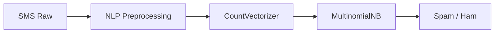

# SMS Spam Detector (NLP & Naive Bayes)

Sistema de clasificación de mensajes SMS en tiempo real (*Spam* vs. *Ham*) utilizando procesamiento de lenguaje natural (NLP) y el algoritmo **Multinomial Naive Bayes**, optimizado mediante `GridSearchCV` y empaquetado en una *Pipeline* de Scikit-Learn.

## Resultados del Modelo

- **F1-Score (Cross-Validation 5-fold):** ~0.93
- **Dataset:** 5,574 mensajes etiquetados del *SMS Spam Collection Dataset* (UCI ML Repository).
- **Métricas Clave:** F1-Score optimizado para mitigar falsos positivos en correo legítimo (*ham*).

## Arquitectura del Pipeline



1. **Preprocesamiento NLP:** Limpieza por Regex (preservando `$` y `!`), Tokenización, eliminación de *Stop Words* y *Stemming* (PorterStemmer) mediante NLTK.
2. **Vectorización:** Extracción de Unigramas y Bigramas (`ngram_range=(1,2)`).
3. **Clasificación:** Ajuste de suavizado Lidstone/Laplace ($\alpha$) con `GridSearchCV`.

## Instalación y Uso

1. **Clonar el repositorio:**
   ```bash
   git clone https://github.com/ethan-carrillodealbornoz/sms-spam-detector.git
   cd sms-spam-detector
   ```

2. **Instalar dependencias:**
   ```bash
   pip install -r requirements.txt
   ```

3. **Ejecutar el pipeline completo:**
   ```bash
   python src/train.py
   ```

4. **Usar streamlit para usar la interfaz gráfica**
   ```bash
   streamlit run app.py
   ```
## Estructura del Repositorio

- `notebooks/`: Explicación teórica paso a paso y análisis exploratorio de datos.
- `src/`: Código modularizado para preprocesamiento y entrenamiento.
- `models/`: Artefacto del modelo entrenado (`.joblib`).
- `data/`: Dataset utilizado para el entrenamiento.

## 📜 Licencia

Este proyecto está bajo la Licencia MIT. Consulta el archivo `LICENSE` para más detalles.